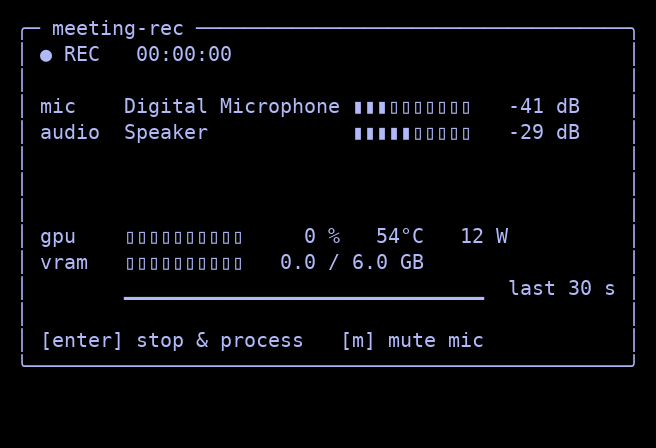

# meeting-asr

Processing shown 6× faster. Audio: NASA Apollo 11 onboard recording (public domain).

Press a hotkey, have your meeting, get a Markdown note: a short summary plus the transcript labelled by speaker. It works with Teams, Meet, any other app, or people in the room.

A 31-min English meeting becomes a note in about 3 min on a 6 GB laptop GPU. Speech-to-text and speaker separation run locally. For the summary, the transcript goes to Claude, or stays on your machine with `SUMMARY=local`.

| Key | Does |
|---|---|
| hotkey | start, or stop and process |
| `m` | keep your voice out of the recording |
| `o` | open the note in Obsidian |

Linux + NVIDIA GPU. Setup, speeds and how it works: [docs/details.md](docs/details.md). License: MIT.
